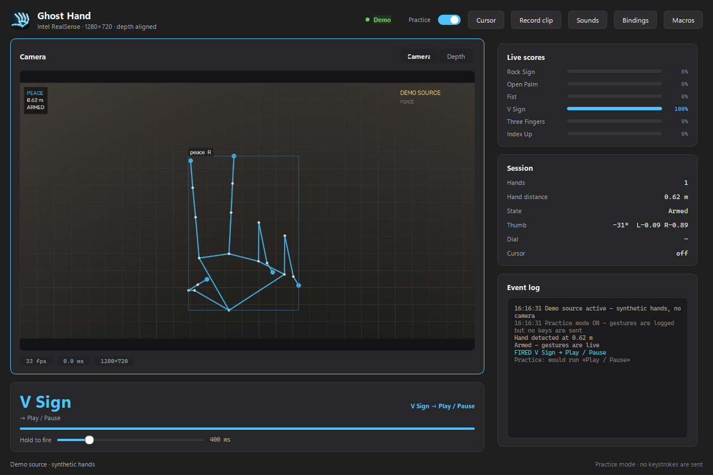

# Ghost Hand



Control Windows with hand gestures in front of an Intel RealSense camera: media keys, app
switching, a point-and-pinch cursor, macros, a soundboard, and per-app profiles. It lives in
the tray with a live preview of exactly what the camera sees and what the classifier thinks.
The icon is the same 21-landmark skeleton the app tracks.

## Download and run (no commands)

1. Open the **Releases** page and download `GhostHand-<version>-win64.zip`.
2. Extract it anywhere (right-click → Extract All).
3. Double-click **GhostHand.exe**.

That's it — nothing is installed and no admin rights are needed. Settings and debug clips
are written next to the exe, so the folder is portable (USB stick friendly).

Windows may say *"Windows protected your PC"* because the exe isn't code-signed: click
**More info → Run anyway**.

The first launch opens a short guide, then the camera preview.

Want Start-menu and desktop shortcuts? Double-click **`Install shortcuts.cmd`** in the same
folder. Autostart is a toggle in the tray menu.

**Requirements:** Windows 10/11 and an Intel RealSense D435 for the depth features. Pose
gestures work with any webcam; no Python needed for the packaged build.

## Build from source

```bat
python -m venv .venv
.venv\Scripts\python.exe -m pip install -r requirements.txt
run.bat
```

`run.bat` starts the tray app without a console; `run-debug.bat` keeps the console so you
see tracebacks. There is no camera? The whole interface runs against a synthetic hand:

```bat
.venv\Scripts\python.exe src\main.py --demo
```

Useful developer entry points:

```bat
.venv\Scripts\python.exe scripts\doctor.py                       :: why can't it see the camera?
.venv\Scripts\python.exe scripts\probe.py --frames 120 --save     :: headless detection test
.venv\Scripts\python.exe scripts\pose_check.py                    :: classifier sanity check
```

Build the portable zip that releases are made from:

```powershell
.\build.ps1        # PyInstaller + smoke test
.\package.ps1      # release\GhostHand-<version>-win64.zip
```

Pushing a tag like `v0.6.0` makes GitHub Actions build and attach that zip automatically.

---

## Default gestures

| Gesture | Action | Notes |
| --- | --- | --- |
| Rock sign (hold ~0.5 s) | *arm* | Index + pinky up. Deliberate, so it rarely triggers by accident. Auto-disarms after 6 s without a hand. |
| V sign | Play / Pause | |
| Thumbs up (hold) | Volume up | Ramps while held, ~2% every 110 ms. |
| Thumbs down (hold) | Volume down | Same ramp, downward. |
| Fist + thumb left | Previous track | |
| Fist + thumb right | Next track | |
| Index up | Mute | |
| Pinch thumb+index, rotate wrist | Volume dial | Continuous; tunable in Bindings |
| Open palm swipe (←/→/↑/↓) | *unbound* | Motion gesture; bind it in Bindings |

Also implemented but unbound: fist, three fingers, OK sign.

Rebind later by editing `config/settings.json` (`bindings` array) — or use the in-app
**Bindings** editor, which also holds the volume-dial tuning.

---

## Macros

**Macros** in the header opens the recorder:

1. **Record** — global hooks capture keys, clicks and scroll, in any app. Stop with
   the button or **Ctrl+Alt+M**.
2. Name it when prompted; it's saved to `config/settings.json` and appears under
   **Macros** in the Bindings picker as `Play: <name>`.
3. **Play** replays it through `pynput` (speed-scaled, cancellable).

Playback sends real input to whatever window has focus, regardless of practice mode —
that's the point of a macro, but it means you should check the target before binding one
to a gesture. Bindings are cleared automatically if you delete a macro.

---

## Point-and-pinch cursor

Toggle **Cursor** in the header (also in the tray menu). While it's on, hold your index
finger up with the others curled and the Windows pointer follows it; pinch thumb and index
to click.

- **One Euro smoothing** (Casiez et al., CHI 2012): `cursor.one_euro_min_cutoff` (0.35)
  sets steadiness at rest, `cursor.one_euro_beta` (0.08) sets how quickly it keeps up with
  fast movement. Lower cutoff = steadier but laggier.
- **The pointer freezes while you pinch**, so closing your hand doesn't drag the cursor
  off the target you aimed at.
- **Pinch hysteresis**: engages at `pinch_enter` (0.40), releases at `pinch_exit` (0.55),
  so a hand hovering at the boundary can't produce click chatter.
- **Tap vs drag**: a short pinch clicks; holding past `drag_hold_ms` (400 ms) presses and
  holds the left button until you release. A held drag is always released if your hand
  leaves the frame.
- **Spans all monitors** (`virtual_screen`), so the pointer reaches your second display.
- Only the index-only pose drives the pointer, so the other gestures keep working while
  cursor mode is on. The one conflict: `Index Up` is bound to Mute, so pointing is
  suppressed while cursor mode is active.

---

## Design notes from comparable projects

Surveyed while building: GestureHud, Air-Cursor, handcontrol, airmouse, Mouseless,
Vimoose and Mausely. Techniques adopted here:

| Insight | Where it came from | Status |
| --- | --- | --- |
| One Euro filter instead of fixed smoothing | nearly all of them | done |
| Freeze pointer while pinching / "click rewind" | Mausely, Mouseless | done |
| Pinch hysteresis (Schmitt trigger) | Mouseless, Mausely | done |
| Tap vs hold-to-drag separation | Mouseless, airmouse | done |
| Virtual-screen / multi-monitor mapping | Mausely | done |

Deliberately not adopted, and why:

- **Learned gesture classifier** (Mausely's 7.5k-param MLP): they report 99.6% on
  synthetic data, but our rule-based scorer is inspectable in the UI, needs no training
  data, and already separates poses with wide margins. Worth revisiting only if a pose
  proves unreliable on real hands.
- **Kalman filter** (hand_mouse): strictly worse than One Euro at equal jitter, per
  Casiez et al. and the comparisons those projects publish.
- **5-point perspective calibration** (handcontrol): genuinely better for extreme camera
  angles; our rectangular region is adequate for a monitor-top camera and far simpler.
- **Full-screen HUD overlay** (GestureHud, Air-Cursor): nice presentation, but the app
  window already shows the same information and the overlay adds a click-through window
  and a per-frame compositor.

---

## Soundboard

**Sounds** in the header. Add `.wav`, `.mp3`, `.ogg` or `.flac` files, then bind them to
gestures in Bindings under **Sounds**.

Routing (in the Soundboard dialog):

- **Play into the mic** feeds `CABLE Input` — the VB-Audio virtual cable — so call apps
  hear it. Pick **`CABLE Output`** as your microphone in Discord/Zoom/Teams.
- **Also hear it on my speakers** plays locally at the same time. Both paths mix
  independently.
- Up to 8 sounds overlap per output device; volume is global plus per-sound.
- If no cable is found it falls back to your speakers and says so in the dialog.

Sounds play regardless of practice mode — they're output, not input.

---

## How it works

```
RealSense D435 ──► camera.py     colour 1280x720 + depth aligned & mirrored
                   hands.py      MediaPipe Hand Landmarker → 21 points, either hand
                   gestures.py   landmark geometry → pose scores → stability → arming → firing
                   actions.py    SendInput / system calls (practice mode blocks this)
                   ui/           PySide6 tray app + preview window
```

Design notes worth knowing:

- **Geometry, not machine learning, for poses.** Finger extension is measured as
  `dist(tip, wrist) / dist(pip, wrist)`; thumb direction comes from the MCP→tip vector.
  Fuzzy `min`/`max` logic composes poses (`peace = min(index, middle) * (1 - max(ring, pinky))`)
  so contradictory poses can't both score high. That makes every bar in the UI explainable,
  and means new poses are a few lines, not a training run.
- **Depth is used for gating**, not classification: hands outside 0.20–2.00 m are ignored, which
  kills background people and arms resting on the desk. Palm distance is shown live.
- **Stability before action.** A gesture must win a 5-frame majority before it counts, then
  hold 140 ms, then a cooldown applies, and it can't re-fire until you release the pose.
- **Practice mode is on by default** (`safety.practice_mode`). It logs what it *would* do.

---

## Layout

```
src/gr/
  camera.py      RealSense capture, depth alignment, distance probing
  hands.py       MediaPipe wrapper (21 landmarks, handedness, palm depth)
  gestures.py    feature extraction, pose scoring, arming, ramp, rotary dial
  pipeline.py    wires camera → tracker → engine → actions, annotates frames
  actions.py     key chords / media keys via SendInput, app launch, macro playback
  macros.py      global input recorder + interruptible player
  synthetic.py   parametric synthetic hands (demo mode + classifier tests)
  recorder.py    1.5 s debug clip ring buffer → debug/*.mp4
  config.py      defaults, gesture library, action catalogue, JSON settings
  profiles.py    foreground-app detection + match rules
  calibration.py cursor-region and depth-window maths
  ui/            tray app, preview window, bindings editor, macros, sounds, calibrator
scripts/         doccount, headless probe, pose/arm/ramp/dial/macro checks
config/          settings.json (created on first save)
debug/           screenshots, clips, probe output
```

---

## Swipes

Hold an open palm and move it quickly left, right, up or down. They arrive unbound as
`Swipe Left/Right/Up/Down` in the Bindings list.

- Travel is measured in **pixels normalised by hand size**, so the threshold works at any
  distance from the camera (`swipe_min_distance`, default 1.3 hand lengths).
- The dominant axis must beat the other by 1.4×, so diagonal moves do nothing.
- Detection runs over a 320 ms window; slow drift can't trigger it.
- After a swipe the held pose is latched, so an open palm bound to an action won't also
  fire as you swipe past it.
- Cooldown is 600 ms between swipes.

---

## Two-hand chords

Raise **both hands** and hold a configured pair of poses. Chords ship with three
defaults (`Both Palms`, `Fist + Palm`, `Both Fists`) and appear in Bindings as
`chord:…`. Add or change pairs in `settings.json` under `chords`, e.g.

```json
{ "id": "both_palms", "name": "Both Palms", "left": "open_palm", "right": "open_palm" }
```

Each hand needs its own stable 5-frame history, order doesn't matter, chords require
arming, and a held chord fires once (900 ms cooldown). While a chord fires, single-hand
poses are suppressed so you don't get a double action.

---

## Custom gestures

**Bindings → Custom…** records a hand shape you invent:

1. Hold the shape in view and press **Record** (2 s).
2. Name it; it's saved and appears in the gesture list as `Custom: <name>`.
3. Bind it like any other gesture.

Matching is a shape descriptor: landmarks translated to the wrist, rotated so the
wrist→middle-knuckle axis points up, and scaled by hand size. That makes it invariant to
where your hand is, how far away it is, and how your wrist is rolled. Distance is turned
into a 0..1 score and fed through the same stability/arming/hold pipeline as built-in
poses, so learned gestures behave identically (including the hold-to-fire delay).

---

## Profiles

**Bindings → Profiles…** creates per-application override sets. A profile has a match rule
of process-name substrings, e.g. `spotify.exe, vlc.exe`; while that app is focused its
bindings take precedence, and anything it leaves unset falls back to the default set.

The **Profile** selector at the top of the Bindings window chooses which set you're
editing. The active profile is resolved from the focused window every 500 ms and the
switch is logged (`Profile: Media (focused: spotify.exe)`).

---

## Calibrating the cursor

With **Cursor** enabled, a **Calibrate** button appears in the header. The wizard walks you
through pointing at the four corners of your comfortable reach, then asks you to move your
hand toward and away from the camera.

- The four fingertip positions become `cursor.region_*`, so the whole screen is reachable
  without stretching.
- The depth pass sets `detection.min/max_distance_m` with 10 cm padding.
- Anything you skip is left unchanged; closing early keeps whatever was already captured.

---

## Packaging

```powershell
.\build.ps1            # icon + PyInstaller + smoke test
.\build.ps1 -Clean     # wipe build/ and dist/ first
```

Produces `dist\GhostHand\GhostHand.exe` (about 416 MB, mostly MediaPipe and
Qt). It's a **one-folder** build rather than one-file: the one-file variant unpacks the
whole runtime to `%TEMP%` on every launch, which is a bad trade for something that
auto-starts with Windows.

The executable is self-contained — config and debug output live next to it, and the hand
model is bundled. `build.ps1` finishes by launching the exe with the demo source for 8
seconds and asserting it exits cleanly, so a broken bundle is caught immediately.

Install for the current user, no admin required:

```powershell
.\installer\install.ps1 -Launch
.\installer\install.ps1 -Uninstall
```

That copies to `%LOCALAPPDATA%\Programs\GhostHand`, creates Start-menu and desktop
shortcuts, and leaves autostart to the tray toggle. `installer\GhostHand.iss` is a
ready-made Inno Setup script if you want a single `Setup.exe` instead.

## First run

The first launch opens a **seven-step guide** covering what the app does, arming, the
gesture table, practice vs live mode, bindings/macros/sounds, the cursor, and the tray. It
sets `ui.guide_seen` when closed; uncheck "Open this guide at startup" to stop it, and
reopen it any time with the **?** button in the header or **How it works…** in the tray.

## Checking for conflicts

**Bindings → Check** scans the settings for things that would behave unexpectedly:

- one gesture bound to two different actions (only one can ever fire),
- the same action wired to several gestures,
- bindings pointing at a deleted macro, sound or custom gesture,
- a "Launch App" binding with no path,
- the arming pose given an action (it is never fired),
- learned gestures whose shapes are too similar to tell apart,
- duplicate two-hand chord definitions.

It reports errors and warnings with a one-click **Remove duplicate bindings**. The same
check runs at startup and summarises findings in the event log.

## Configuration

`config/settings.json` is created on first save; missing keys fall back to defaults in
`config.py`.

| Key | Default | Meaning |
| --- | --- | --- |
| `camera.color_width/height` | 1280×720 | Colour stream resolution |
| `camera.depth_width/height` | 848×480 | Depth stream, aligned to colour |
| `engine.arm_mode` | `pose` | `pose` (hold the arming gesture) or `always` |
| `engine.arm_hold_ms` | 550 | How long to hold the arming pose |
| `engine.arm_pose` | `rock` | Which gesture arms the app |
| `ui.guide_seen` | `false` | Set once the first-run guide has been shown |
| `engine.auto_disarm_ms` | 6000 | Disarm after this long with no hand |
| `engine.pose_threshold` | 0.55 | Minimum score to accept a pose |
| `engine.stability_frames` | 5 | Majority window |
| `engine.fire_hold_ms` | 400 | How long a gesture must be held before it fires |
| `engine.volume_hold_ms` | 300 | Hold time before the volume ramp starts |
| `engine.cooldown_ms` | 450 | Minimum gap between actions |
| `engine.dial_enabled` | `true` | Pinch + wrist-rotate volume dial |
| `engine.dial_degrees_per_step` | 6.0 | Wrist rotation per volume tick (lower = finer) |
| `engine.dial_invert` | `false` | Flip dial direction |
| `soundboard.mic_route` | `true` | Play sounds into the virtual cable |
| `soundboard.monitor` | `true` | Also play on your speakers |
| `soundboard.volume` | 0.8 | Global soundboard volume |
| `soundboard.cable_device` | `""` | Output device hint (auto: "CABLE Input") |
| `cursor.enabled` | `false` | Point-and-pinch pointer mode |
| `cursor.one_euro_min_cutoff` | 0.35 | Steadiness at rest (lower = steadier) |
| `cursor.one_euro_beta` | 0.08 | Responsiveness to fast movement |
| `cursor.gain` | 1.0 | Amplify hand movement |
| `cursor.pinch_enter` / `pinch_exit` | 0.40 / 0.55 | Click hysteresis thresholds |
| `cursor.drag_hold_ms` | 400 | Hold past this to drag instead of click |
| `cursor.click_cooldown_ms` | 320 | Minimum gap between pinch clicks |
| `engine.swipe_enabled` | `true` | Directional open-palm swipes |
| `engine.swipe_pose` | `open_palm` | Pose required to start a swipe (`""` = any) |
| `engine.swipe_min_distance` | 1.3 | Travel needed, in hand lengths |
| `engine.swipe_cooldown_ms` | 600 | Gap between swipes |
| `engine.chord_enabled` | `true` | Two-hand chords |
| `engine.chord_cooldown_ms` | 900 | Gap between chord fires |
| `engine.volume_ramp_interval_ms` | 110 | Volume tick rate while holding |
| `detection.min/max_distance_m` | 0.20 / 2.00 | Depth gating window |
| `safety.practice_mode` | `true` | Never send keystrokes |

---

## Troubleshooting: "Access is denied"

If the app reports `MFCreateDeviceSource ... HResult 0x80070005`, Windows is refusing camera
access to user processes. Device Manager can look perfectly healthy — the block is in the
camera stack, not the driver. Run `scripts/doctor.py` first; then, in order:

1. **Unplug the RealSense and plug it back in.** Prefer a rear USB 3 port, direct on the board.
2. **Close anything that can hold a camera**: NVIDIA Broadcast, OBS, Discord camera preview,
   Teams, Phone Link.
3. **Restart the frame server** (elevated PowerShell — this is the most common fix):
   ```powershell
   Restart-Service FrameServer
   ```
4. **Reset the device** (elevated):
   ```powershell
   pnputil /restart-device "USB\VID_8086&PID_0B07&MI_00\6&6cdf577&0&0000"
   ```
5. **Reboot.** A wedged UVC claim survives almost everything else.

Check Settings → Privacy & security → Camera: both "Camera access" and "Let desktop apps access
your camera" must be on.

---

## Roadmap

1. ~~Binding editor~~ — done: pick a gesture, assign any action, set an app path for
   "Launch App", and tune the volume dial.
2. ~~Macro recorder~~ — done: record keys/clicks/scroll, name it, bind it to a gesture.
3. ~~Point-and-pinch cursor~~ — done: index fingertip drives the Windows pointer.
4. ~~Soundboard~~ — done: layered sound bites with virtual-cable mic routing.
5. ~~Swipe gestures~~ — done: open-palm swipes with hand-size-normalised thresholds.
6. ~~Held-combo / two-hand chords~~ — done: configured pose pairs, order-independent.
7. ~~Custom gesture training~~ — done: record a shape, match it rotation/scale/position invariant.

The original roadmap is complete. Built on top of it since:

- **Packaging** — one-folder exe, installer scripts, and a build that smoke-tests itself.
- **Per-app profiles** — override bindings by focused application.
- **Cursor calibration wizard** — four-corner region plus depth window.

Still open, if you want them later: per-gesture sensitivity tuning UI, a first-run
setup flow, and an optional always-on-top overlay.
